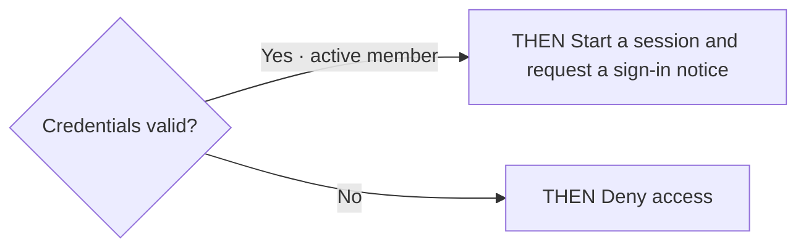
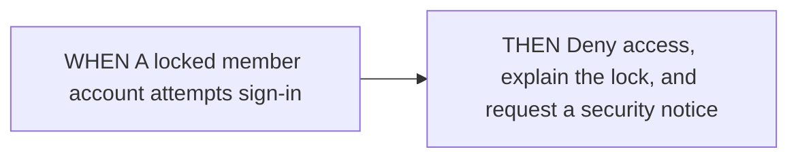

<!-- opsx-chart:generated v1 -->
# authentication

**Proposed view:** current specs with this change's deltas applied for reading only. OpenSpec remains responsible for validation and merging.

Generated for reading. Change the specification and regenerate this view.

## Sources

- [openspec/specs/authentication/spec.md](../../../../specs/authentication/spec.md)
- [openspec/changes/adjust-login/specs/authentication/spec.md](../../specs/authentication/spec.md)

## Sign in

### Credential check

The locked-account case can overlap invalid credentials. The spec does not establish priority, so that case is shown separately.

| Source scenario | WHEN conditions |
| --- | --- |
| Valid credentials | An active member supplies valid credentials |
| Invalid credentials | A member supplies invalid credentials |

### Locked account

