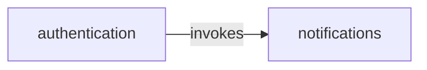

<!-- opsx-chart:generated v1 -->
# Specification map

**Proposed view:** current specs with this change's deltas applied for reading only. OpenSpec remains responsible for validation and merging.

Generated for reading. Change the specification and regenerate this view.

Arrows run from the referring/dependent spec to the referenced spec. Dotted edges are interpretations, not declared dependencies.

## Evidence

- **authentication → notifications** (invokes, explicit): “The system SHALL request sign-in notices from \[notifications\](../notifications/spec.md).” — [source](../specs/authentication/spec.md).

## Scenario views

- [authentication](flows/authentication.md)
