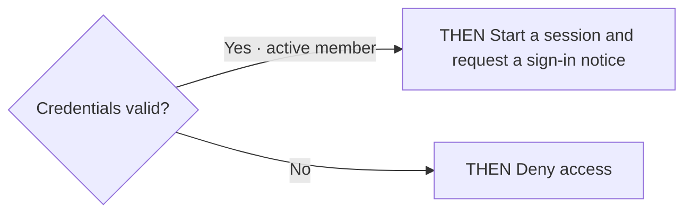

<!-- opsx-chart:generated v1 -->
# authentication

**Current view:** derived from the current OpenSpec specifications.

Generated for reading. Change the specification and regenerate this view.

## Sources

- [openspec/specs/authentication/spec.md](../../specs/authentication/spec.md)

## Sign in

### Credential check

| Source scenario | WHEN conditions |
| --- | --- |
| Valid credentials | An active member supplies valid credentials |
| Invalid credentials | A member supplies invalid credentials |
