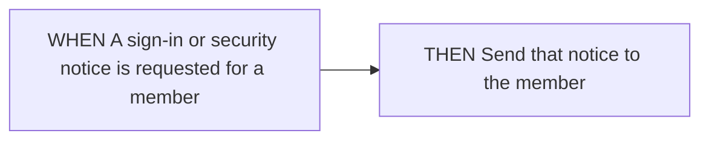

<!-- opsx-chart:generated v1 -->
# notifications

**Current view:** derived from the current OpenSpec specifications.

Generated for reading. Change the specification and regenerate this view.

## Sources

- [openspec/specs/notifications/spec.md](../../specs/notifications/spec.md)

## Deliver notice

### Notice requested

