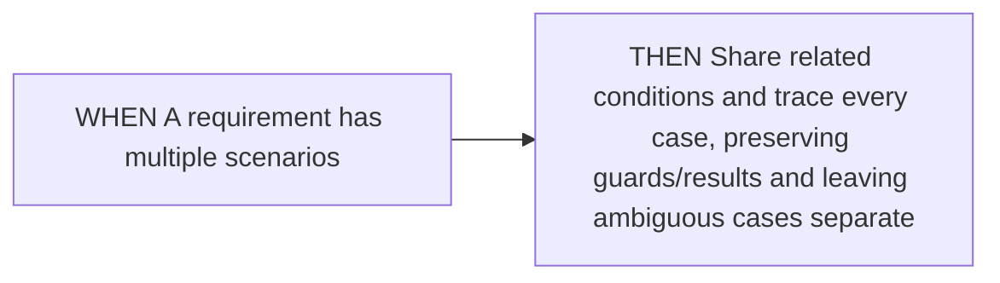
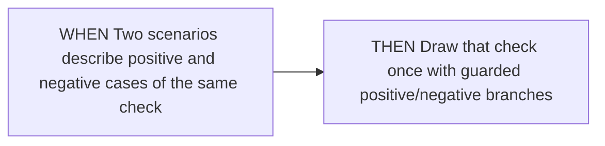
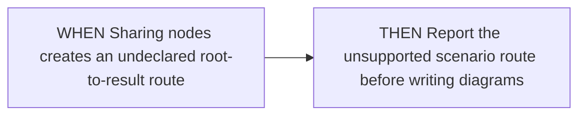
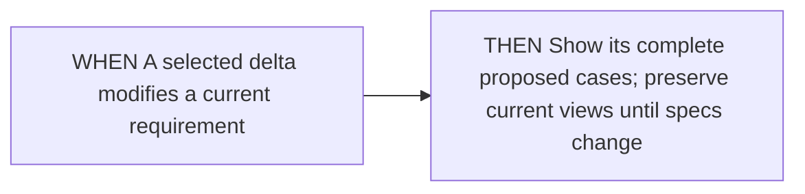
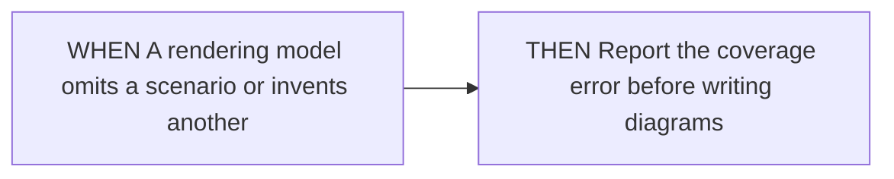
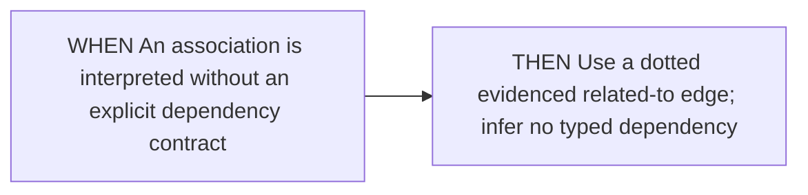
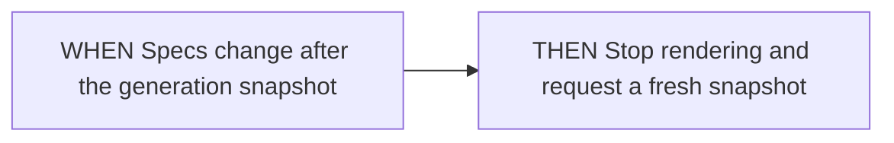
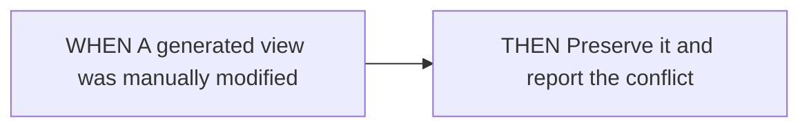
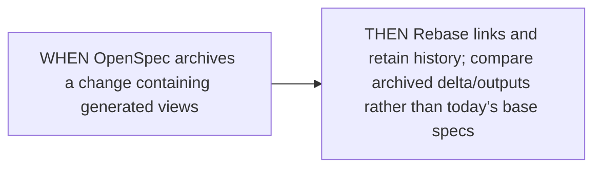

<!-- opsx-chart:generated v1 -->
# readable-diagrams

**Current view:** derived from the current OpenSpec specifications.

Generated for reading. Change the specification and regenerate this view.

## Sources

- [openspec/specs/readable-diagrams/spec.md](../../specs/readable-diagrams/spec.md)

## Represent every selected scenario

### Multiple cases in a requirement

### Positive and negative cases

### Shared graph introduces extra routes

### Changed requirement

### Incomplete coverage

## Show evidenced capability relationships

### Inferred association

## Preserve source and output ownership

### Source changed during generation

### Hand-edited drawing

### Archived proposal

