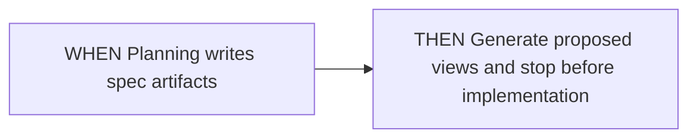
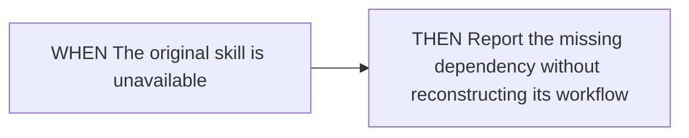
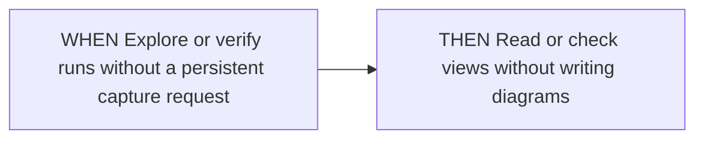
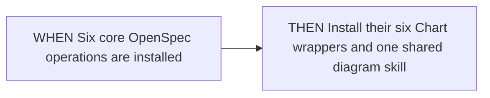
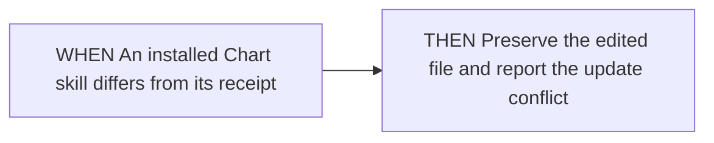
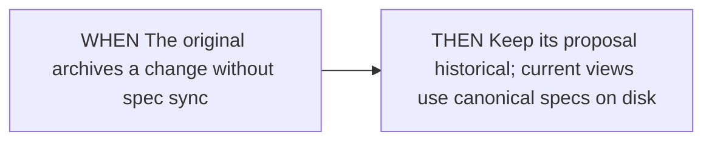
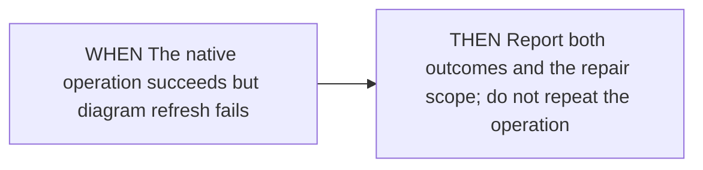

<!-- opsx-chart:generated v1 -->
# workflow-extension

**Current view:** derived from the current OpenSpec specifications.

Generated for reading. Change the specification and regenerate this view.

## Sources

- [openspec/specs/workflow-extension/spec.md](../../specs/workflow-extension/spec.md)

## Compose the original operation

### Planning writes specifications

### Original skill is unavailable

### Read-only operation

## Install alongside existing skills

### Core profile

### Modified installation

## Respect current and historical scope

### Archive without synchronization

### Diagram generation fails after native success

