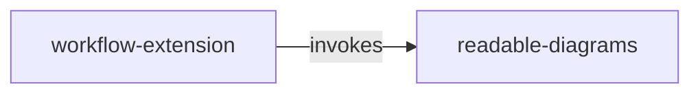

<!-- opsx-chart:generated v1 -->
# Specification map

**Current view:** derived from the current OpenSpec specifications.

Generated for reading. Change the specification and regenerate this view.

Arrows run from the referring/dependent spec to the referenced spec. Dotted edges are interpretations, not declared dependencies.

## Evidence

- **workflow-extension → readable-diagrams** (invokes, explicit): “the wrapper generates their proposed views through readable-diagrams” — [source](../specs/workflow-extension/spec.md).

## Scenario views

- [readable-diagrams](flows/readable-diagrams.md)

- [workflow-extension](flows/workflow-extension.md)
